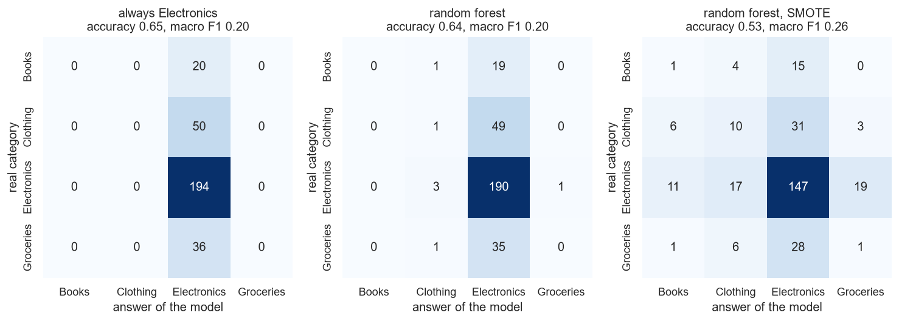
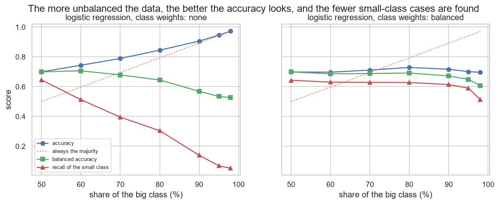

# Customer behavior analysis: missing labels, unbalanced classes and an accuracy that lies

**Author:** MohammadMahdi Faraji
**Course:** Machine Learning (Prof. Hamed Baghban). This was homework 1 of the course (fall 2024). I redid it after the course as a small worked example for people who are just starting with machine learning.

An online shop has a table of 1000 customers, but for 700 of them it doesn't know what kind of product they bought. The homework asked to fill in the gaps, check whether the categories are balanced, measure a classifier and describe the valuable customers. The interesting part turned out to be a trap: a model with 70 % accuracy that had learned nothing at all.

<p align="center"></p>
<p align="center"><sub>Each row is the real category, each column is the model's answer. Left: a "model" that always says Electronics. Middle: a random forest, which does almost exactly the same thing. Right: the same forest trained with SMOTE, which spreads its answers but still can't tell the categories apart.</sub></p>

## What this is about, in plain words

Imagine a teacher who answers "true" to every true/false question. If 65 % of the questions are true, the teacher gets 65 % right without reading a single question. That's exactly what happened in my first version of this homework: the random forest answered "Electronics" for every customer, and because 65 % of the customers are Electronics buyers, it scored 70 % on a small test set. It looked like a decent result. It was the share of Electronics in the test set.

This repository is the redone homework. It answers the six tasks of the assignment ([`docs/assignment.md`](docs/assignment.md)), and on the way it shows three things every beginner runs into sooner or later:
- **Missing values:** how to check *why* they are missing, and why filling them with a model can make things worse.
- **Unbalanced classes:** why accuracy is the wrong number to look at, and what to look at instead.
- **Honest testing:** compare with the simplest possible rule, and never test a model on values that a model made up.

## At a glance

| | |
|---|---|
| Data | 1000 customers of an online shop (synthetic data from the course), 12 columns |
| Missing | the purchase category of 700 customers, missing completely at random |
| Categories (300 known) | Electronics 65 %, Clothing 17 %, Groceries 12 %, Books 7 % |
| Methods | correlation, ANOVA and chi-square tests, k-means, logistic regression, decision tree, random forest, class weights, oversampling, SMOTE, repeated cross-validation, permutation test |
| Main result | no model beats "always Electronics" (accuracy 0.65) or random guessing (macro F1 about 0.24) |
| Valuable customers | the top 20 % by spending bring 42 % of the money, and they look like everyone else |
| Runs in | about 2 minutes, in Colab or locally |

## Results

**1. The category can't be predicted.** I tested every model with repeated 5-fold cross-validation on the 300 customers with a known category (25 tests per model), and compared them with two rules that don't look at the customer at all:

| | accuracy | balanced accuracy | macro F1 |
|---|---:|---:|---:|
| always "Electronics" | 0.65 | 0.25 | 0.20 |
| random guess with the known shares | 0.45 | 0.23 | 0.23 |
| logistic regression | 0.64 | 0.26 | 0.21 |
| random forest | 0.64 | 0.25 | 0.20 |
| random forest with SMOTE | 0.52 | 0.25 | 0.24 |
| logistic regression with class weights | 0.22 | 0.25 | 0.19 |

All 10 models are in [`results/model_comparison.csv`](results/model_comparison.csv). In plain words:
- **Accuracy** is never better than always saying Electronics.
- **Balanced accuracy** (the hit rate inside each category, averaged) stays around 0.25, which is what you get by guessing among four categories.
- **Macro F1** (every category counts the same) is not clearly better than random guessing: 0.24 against 0.23, while it changes by about 0.05 from one test to the next.
- A **permutation test** (train the model again on shuffled categories, 200 times) gives p = 0.40: the model does no better on the real categories than on random ones.

**2. Filling the gaps with a model makes things worse.** A classifier trained on the 300 known customers calls 687 of the 700 unknown ones "Electronics". After that, 88 % of all customers look like Electronics buyers, much more unbalanced than the real 65 %. And if you then test a new model on this filled-in table, the accuracy jumps to 0.88. Nothing was learned; one model simply agrees with another one. This is called *data leakage*. I filled the gaps with random draws that keep the known shares, and marked every filled value, so that only real categories are used for testing.

**3. Valuable customers.** Spending is very uneven: the median customer spends about 84, the top 20 % spend at least 147 and bring 42 % of all the money. But these big spenders have the same age, gender, region, time on the website and categories as everyone else. Only the number of viewed products is slightly higher (10.7 against 9.7). So in this data, valuable customers can only be found by their spending, not by who they are.

**4. What an unbalanced class does to accuracy.** To show the effect where a model *can* learn something, I generated a simple two-class problem and made the small class rarer and rarer:

<p align="center"></p>

Without class weights (left), the accuracy climbs from 0.70 to 0.97 while the share of the small class that the model finds falls from 0.65 to 0.05. At 98 to 2, the model is hardly different from always answering the big class. With class weights (right), it still finds about half of the small class, at the price of a lower accuracy.

## How it works, step by step

**0. Check why values are missing.** The 300 customers with a category and the 700 without one have the same averages in every column (all p-values above 0.1), and a model can't tell the two groups apart (ROC AUC 0.50). So the gaps are random, and the 300 known rows are a fair sample.

**1. Correlation (task 1).** Only the five unnamed columns `Feature_1` to `Feature_5` are correlated with each other (the strongest pair has *r* = −0.80). A scatter plot shows why: they form four separate clouds of exactly 250 customers each, the typical output of a random data generator. No column is clearly related to the category. I removed no column: none is a copy of another, and the spending columns are needed for the valuable-customer question. (My first version removed `Purchase_Amount`, which is exactly the column that question is about.)

**2. Missing categories (task 2).** I compared three ways to fill them (the most common value, a model, random draws with the known shares) and kept the random draws plus a `category_filled` column. The completed table is [`results/completed_dataset.csv`](results/completed_dataset.csv).

**3. Balance (task 3).** A bar chart shows almost ten Electronics buyers for every book buyer. The notebook explains class weights, random oversampling, SMOTE and undersampling, and shows SMOTE on the known rows. Balancing is always done inside the training part of each test, never on the test data.

**4. Confusion matrix and F1 (task 4).** Ten models (logistic regression, decision tree and random forest, each plain and with class weights, oversampling or SMOTE) against the two simple rules, with accuracy, balanced accuracy, macro F1 and weighted F1, confusion matrices and a permutation test.

**5. Customer behavior (task 5).** Spending distribution, the top 20 %, a comparison of big spenders with the others, and four behavior segments from k-means on spending, time on the website and viewed products.

**6. Effect of imbalance (task 6).** Our own numbers, plus the controlled experiment above.

## What went wrong in my first version

The original notebook is kept in [`legacy/original_course_submission/`](legacy/original_course_submission/), with a table of every problem and where to find it. The main ones:
- It only ran because of variables left over from earlier runs. In a fresh session, it stops with a `NameError`.
- The confusion matrix under "Decision Tree" was actually the random forest's.
- The random forest and the neural network predicted "Electronics" for every test customer, and the weighted F1 hid this.
- The 700 gaps were filled by the random forest, which turned 883 of the 1000 customers into Electronics buyers.
- The written discussion and tasks 5 and 6 were missing.

All details: [`docs/changes_from_course_project.md`](docs/changes_from_course_project.md).

## How much to trust these numbers

- The data is synthetic. The patterns (or the lack of them) say little about real shoppers.
- With only 20 book buyers, every number about books is uncertain.
- `Feature_3` and gender show weak hints about the category (p = 0.006 and 0.015). But with 12 columns tested, a hint like this turns up by pure chance almost every second time. A fair check would need new customers.

## Try it yourself

**In Colab:** open `notebooks/customer_behavior_analysis.ipynb` in Google Colab and choose *Runtime → Run all*. It asks you to upload `data/synthetic_customer_behavior.csv`. The libraries are already in Colab; if `imbalanced-learn` is missing, the first cell installs it.

**Locally** (tested with Python 3.14):
```
pip install -r requirements.txt
cd notebooks
jupyter notebook customer_behavior_analysis.ipynb
```
Run all cells. The plots and tables are written to `results/`. Then this command checks the main numbers again with plain numpy, without pandas or scikit-learn:
```
python tools/check_numbers.py
```

## Files

```
├── notebooks/customer_behavior_analysis.ipynb   the whole analysis, task by task, with explanations
├── data/synthetic_customer_behavior.csv         the data from the course
├── results/                                     plots, the model table, the completed data, a summary
├── tools/check_numbers.py                       independent check of the main numbers
├── docs/                                        the assignment in my own words, what changed since the course
└── legacy/original_course_submission/           my original homework, unchanged except for my student ID
```

## Thanks

- Prof. Hamed Baghban, for the course and the assignment.
- I used an AI assistant to help review and rewrite the code, to clean it up and prepare it for publishing.

## License

MIT, see [LICENSE](LICENSE).
